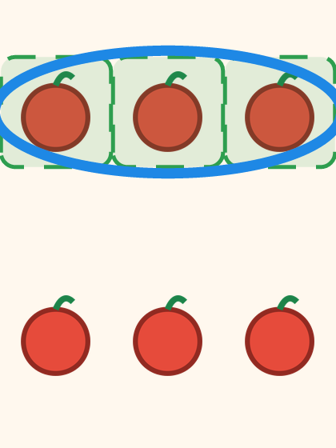
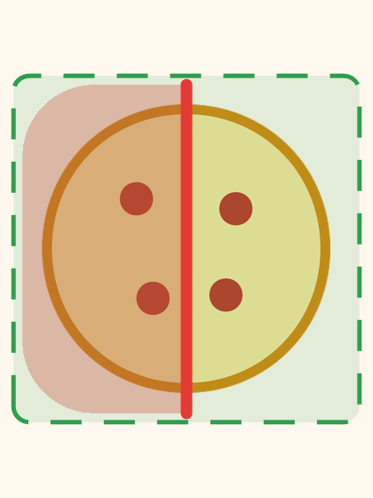

# Halving Fun

A .NET 10 MAUI app for Android and iOS that teaches foundation stage (EYFS)
children to halve a group of things. It is built around the pictures from the
*EYFS Maths: Fair Sharing & Halving!* worksheet: pizza, toast, bread rolls,
apples, biscuits, sweets and berries.

 

## The two games

**Circle Half** - a group of treats appears. The child chooses a felt-tip colour
and draws a ring around half of them, then taps **Check**.

**Cut in Half** - one snack appears. The child draws a single straight line that
splits it into two equal halves.

Both games give the same feedback:

| Answer | What happens |
| --- | --- |
| Correct | Cheerful chime, a star, the items glow green and the answer is read out ("Half of 6 is 3"). |
| Wrong | Gentle buzz, the items circled show red, and a hint suggests counting again. |
| End of round | Fanfare, star total, then a fresh set of questions. |

Every question is spoken out loud so children who cannot read yet can play on
their own. A grown-up can turn the voice off from the home screen, and the star
total can be reset there too (tap "Reset stars" twice).

Questions are graded: a round of eight starts with small groups (half of 2,
half of 4) and works up to groups of 10.

## Requirements

* .NET 10 SDK
* `maui-android` workload for Android, `maui-ios` workload on macOS for iOS
* Android SDK with API 36 platform and build tools, plus a JDK 17 or newer

```bash
dotnet workload install maui-android
```

## Build and run

```bash
# Android
dotnet build src/HalvingFun.csproj -f net10.0-android
dotnet build src/HalvingFun.csproj -t:Run -f net10.0-android

# iOS (on a Mac)
dotnet build src/HalvingFun.csproj -f net10.0-ios
dotnet build src/HalvingFun.csproj -t:Run -f net10.0-ios
```

If the Android SDK is not in the default location, pass
`-p:AndroidSdkDirectory=/path/to/android-sdk`.

## Tests

The answer checking, the picture layout and the ink drawing are platform
neutral, so they are covered by a plain `net10.0` test project that compiles the
same source files and renders the drawing layer with the same Skia backend MAUI
uses on device.

```bash
dotnet test tests/HalvingFun.Tests
```

## How the answers are marked

* **Circle Half** - every pen stroke is treated as a polygon. An even-odd ray
  cast decides which picture centres fall inside it, so one big loop round three
  apples counts as three. Scribbles smaller than a quarter of a picture are
  ignored so a stray tap is never an answer.
* **Cut in Half** - the line has to be within about 30 degrees of straight, run
  at least half the picture's size, pass within 16% of the centre, and reach both
  sides of the picture.

## Project layout

```
src/
  Models/        FoodItem, PenColour, InkStroke, StrokeGeometry, HalvingQuestion
  Drawing/       ItemLayout (where pictures sit) and InkDrawable (pen + feedback)
  Services/      QuestionFactory, HalvingRound, StarBank, sound players, VoiceGuide
  Pages/         HomePage, CircleHalfPage, CutInHalfPage
  Views/         FeedbackOverlay (the "well done / try again" card)
  Platforms/     Android and iOS sound players
  Resources/     Images (worksheet artwork), Raw (sound cues), Styles
tests/
  HalvingFun.Tests/
tools/
  extract_artwork.py   cuts the pictures out of the worksheet PDF
  generate_sounds.py   synthesises the sound cues
```

## Artwork and sounds

The pictures were cut out of the worksheet PDF with `tools/extract_artwork.py`
(PyMuPDF renders each page at high DPI, then the white paper background is
removed and the pictures are trimmed and saved as transparent PNGs). The
worksheet itself is a third party teaching resource and is not part of this
repository; only the pictures the app draws are included.

The five sound cues in `src/Resources/Raw` are generated by
`tools/generate_sounds.py`, so there are no third party audio files to license.
